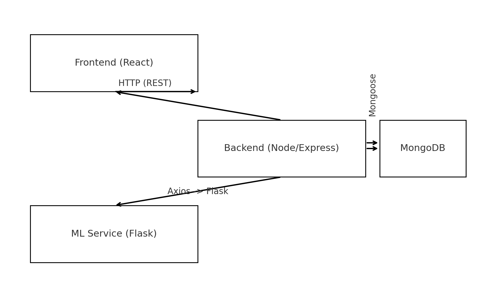
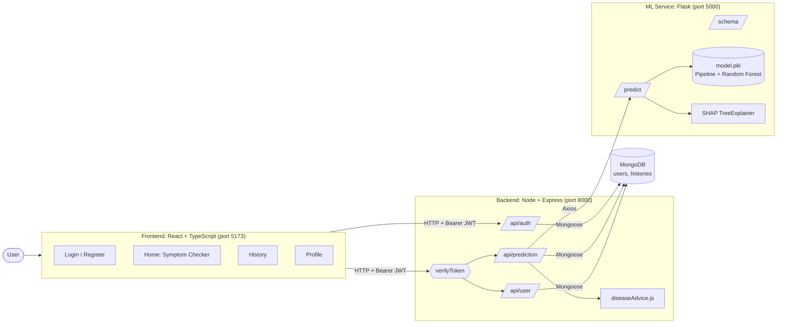

# Health Risk Predictor — Hybrid Framework for Symptom-Based Disease Prediction

> A full-stack web app that predicts the most likely disease from a user's symptoms and lifestyle, **explains why** with SHAP, gives structured health guidance, and keeps a private per-user prediction history.

[](https://www.python.org/)
[](https://nodejs.org/)
[](https://react.dev/)
[](https://flask.palletsprojects.com/)
[](https://www.mongodb.com/)
[](https://scikit-learn.org/)
[](https://shap.readthedocs.io/)

> [!WARNING]
> **Medical disclaimer:** This project is for **educational and demonstration purposes only**. The model is trained on a **synthetic** dataset and is **not** a medical device or a substitute for professional diagnosis. Always consult a licensed healthcare professional.

📘 **New to the project?** Read [`learning.md`](learning.md) for an A-to-Z guide: why each technology was chosen, how every file works, a 7-day build plan, and 20 interview questions with answers.

---

## Table of Contents

- [Overview](#overview)
- [Features](#features)
- [Technology Stack](#technology-stack)
- [System Architecture](#system-architecture)
- [Project Structure](#project-structure)
- [Getting Started](#getting-started)
- [Usage](#usage)
- [API Reference](#api-reference)
- [Dataset and Model](#dataset-and-model)
- [Results and Fairness](#results-and-fairness)
- [Testing](#testing)
- [Troubleshooting](#troubleshooting)
- [Security](#security)
- [Limitations](#limitations)
- [Future Enhancements](#future-enhancements)
- [Contributing](#contributing)
- [References and Acknowledgements](#references-and-acknowledgements)
- [Author](#author)

---

## Overview

**Health Risk Predictor** (shown in the UI as *Hybrid Framework for Health Prediction*) combines a **MERN-style web stack** with a **Python machine-learning microservice**.

A signed-in user enters their **age, sex, diet quality, smoking history, physical activity and symptoms**. The app returns:

- the **predicted condition** and a **confidence score**,
- the **top factors** behind that specific prediction (SHAP),
- **structured guidance**: what to avoid, what to do, prevention, nutrition, notes and an urgency banner,
- and saves everything to the user's **history** in MongoDB.

The model distinguishes **7 conditions**: Anemia, COVID-19, Dengue, Diabetes, Flu, Heart Disease and Kidney Disease.

**Why "hybrid"?** Each part uses the ecosystem it is best at: Python (scikit-learn, SHAP) for ML, and Node/React for the web application, connected over HTTP.

### Problem it addresses

- Online symptom searches give alarming, unexplained results with no record over time.
- Many ML projects stop at a notebook and never show how a trained model becomes a secure, usable application.

This project covers both: an explainable symptom checker **and** a complete path from trained model to authenticated web app.

---

## Features

| Area | What you get |
|---|---|
| 🩺 **Symptom checker** | Age, sex, diet quality, smoking history, physical activity and symptoms (type them, or click symptom chips). Profile values are pre-filled. |
| 🧠 **Prediction** | Random Forest (600 trees) returns the top class and its probability as a confidence bar. |
| 🔍 **Explainability** | Per-prediction SHAP values for the predicted class: top 6 factors, shown green (toward) or red (away). Falls back to feature importances if SHAP fails. |
| ✅ **Input feedback** | Shows which symptoms were used and which were not recognised; rejects requests with no recognised symptom. |
| 📋 **Health guidance** | For each disease: summary, things to avoid, recommended actions, prevention, nutrition, notes and an *urgent* flag. A default covers unknown classes. |
| 🔐 **Authentication** | Register/login with bcrypt-hashed passwords and 7-day JWTs; signed in immediately after registering. |
| 👤 **Profile** | View and edit phone, address, age, sex, diet quality and smoking history; clear any field. |
| 🕘 **History** | Every prediction is saved with inputs, model features, confidence, explanation and advice; newest first, with a detail view. |
| ⚖️ **Fairness report** | Script comparing model metrics across sex and age groups. |
| 🌐 **Global explainability** | Script exporting overall feature importance (SHAP) to JSON. |
| 📱 **Responsive UI** | Works on desktop and mobile widths. |

---

## Technology Stack

| Layer | Technology | Why it was chosen |
|---|---|---|
| Frontend | React 18, TypeScript, Vite 5 | Component-based UI, type safety, fast dev server |
| Styling | Tailwind CSS 3, lucide-react | Utility-first responsive styling, lightweight icons |
| HTTP client | Axios | Interceptor attaches the JWT to every request |
| Backend | Node.js, Express 5 (ES Modules) | Lightweight REST API; async errors handled automatically |
| Auth | jsonwebtoken, bcryptjs | Stateless sessions; slow salted password hashing |
| Database | MongoDB, Mongoose 8 | Nested prediction documents fit naturally; schema validation |
| ML service | Flask, Flask-CORS | Minimal Python API that loads the model once |
| ML | scikit-learn (Pipeline, ColumnTransformer, RandomForest), pandas, NumPy, joblib | Strong defaults for small tabular data; preprocessing saved with the model |
| Explainability | SHAP (TreeExplainer) | Fast, exact per-prediction explanations for tree models |
| Tooling | ESLint, TypeScript compiler, Nodemon, Git LFS | Linting, type checks, auto-reload, large model storage |

The full reasoning behind each choice is in [`learning.md` §4](learning.md#4-technology-choices-and-why).

---

## System Architecture





### Prediction flow

1. The user submits the Home form; Axios sends `POST /api/prediction` with the JWT.
2. `verifyToken` checks the token and sets `req.userId`.
3. The backend **validates** each field and **maps** it to the model's categories (for example `Regular` → `ExerciseFrequency=Regular`). Symptoms are split on commas, semicolons or newlines, normalised, and turned into 28 binary flags.
4. The backend calls Flask `/predict`, which builds a one-row DataFrame, runs the saved pipeline, and returns the prediction, confidence and SHAP explanation for the predicted class.
5. The backend attaches the matching guidance, saves a `History` document, and returns the combined result.
6. The UI renders the confidence bar, factors, guidance cards, notes and urgent banner.

---

## Project Structure

```text
HealthPrediction/
├── backend/                          # Node + Express REST API (port 8000)
│   ├── app.js                        # Entry: env, middleware, routes, error handler, start
│   ├── config/diseaseAdvice.js       # Guidance for the 7 diseases + default
│   ├── controllers/                  # authController, predictionController, userController
│   ├── middleware/verifyToken.js     # JWT check, sets req.userId
│   ├── models/                       # User.js, History.js (Mongoose)
│   ├── routes/                       # authRoutes, predictionRoutes, userRoutes
│   ├── utils/                        # connectDB.js, mlService.js (calls Flask)
│   ├── .env.example
│   └── package.json
│
├── frontend/                         # React + TypeScript + Vite + Tailwind (port 5173)
│   ├── src/
│   │   ├── App.tsx, main.tsx, index.css
│   │   ├── types.ts                  # Shared types, form options, error helper
│   │   ├── lib/api.ts                # Axios instance + JWT interceptor
│   │   ├── context/AuthContext.tsx   # user, token, loading, login/register/logout
│   │   ├── components/               # Navigation, AdviceCards, ExplanationList
│   │   └── pages/                    # Login, Home, History, About (profile)
│   ├── supabase/migrations/          # Leftover from the project scaffold (not used)
│   ├── .env.example
│   └── package.json, vite.config.ts, tailwind.config.js, tsconfig*.json, eslint.config.js
│
├── ml/                               # Python ML service and training (port 5000)
│   ├── app.py                        # Flask API: /health, /schema, /predict
│   ├── preprocessing.py              # Column schema + ColumnTransformer
│   ├── model_training.py             # Train, evaluate, save model.pkl + report
│   ├── explainability.py             # Local and global SHAP explanations
│   ├── fairness_check.py             # Metrics by sex and age group
│   ├── model.pkl                     # Trained pipeline (Git LFS, ~21 MB)
│   ├── training_report.json, fairness_report.csv, global_explain.json
│   ├── requirements.txt
│   └── dataset/                      # git-ignored: place the training CSV here
│
├── database/mongo_setup.js           # Create indexes, optionally seed a dev user
├── docs/                             # api_endpoints.md, architecture_diagram.png, project_report.docx
├── learning.md                       # A-to-Z learning guide
├── .gitattributes                    # Git LFS rules (*.pkl, *.joblib, *.pt, *.onnx, *.h5)
└── .gitignore
```

---

## Getting Started

### Prerequisites

| Tool | Version | Notes |
|---|---|---|
| Node.js + npm | 18+ | Backend and frontend |
| Python + pip | 3.9+ | ML service |
| MongoDB | 6+ | Local (`mongodb://127.0.0.1:27017`) or MongoDB Atlas |
| Git LFS | any | Downloads `ml/model.pkl` |

No external API keys are needed.

### 1. Clone (with Git LFS)

```bash
git lfs install
```

```bash
git clone https://github.com/AdvikaChaithra/HealthPrediction.git
```

```bash
cd HealthPrediction && git lfs pull
```

> If `ml/model.pkl` is only a ~130-byte text file, LFS did not download it. Run `git lfs pull`, or retrain the model (step 3).

### 2. ML service (Flask)

```bash
cd ml
python -m venv .venv
```

Activate the virtual environment, then install the pinned dependencies:

```powershell
.venv\Scripts\activate          # Windows
```

```bash
source .venv/bin/activate       # macOS / Linux
```

```bash
pip install -r requirements.txt
```

### 3. (Optional) Retrain the model

The dataset is not committed. Place it at `ml/dataset/realistic_symptom_disease_dataset.csv`, then run from `ml/`:

```bash
python model_training.py     # model.pkl + training_report.json
```

```bash
python explainability.py     # global_explain.json
```

```bash
python fairness_check.py     # fairness_report.csv
```

> If you change the dataset's categories, update the options in `frontend/src/types.ts` and the maps in `backend/controllers/predictionController.js`. `GET /api/prediction/schema` shows the categories the model knows.

### 4. Backend (Express)

```bash
cd backend
npm install
```

Copy `backend/.env.example` to `backend/.env` and set a long random `JWT_SECRET`:

```env
MONGO_URI=mongodb://127.0.0.1:27017/ai_health_db
JWT_SECRET=change_me_to_a_long_random_string
ML_API_URL=http://127.0.0.1:5000
PORT=8000
```

The server refuses to start if `MONGO_URI` or `JWT_SECRET` is missing.

### 5. (Optional) Bootstrap the database

Creates indexes and can seed a local test user (`admin@health.ai`). **Development only.**

```bash
cd database && npm install && npm run setup
```

### 6. Frontend (React)

```bash
cd frontend
npm install
```

Copy `frontend/.env.example` to `frontend/.env`:

```env
VITE_API_BASE_URL=http://127.0.0.1:8000/api
```

> The `/api` suffix is required: the frontend calls paths like `/auth/login` relative to this URL.

### 7. Start everything

Start MongoDB first, then each service in its own terminal:

```bash
cd ml && python app.py              # http://127.0.0.1:5000
```

```bash
cd backend && npm run dev           # http://127.0.0.1:8000  (or: npm start)
```

```bash
cd frontend && npm run dev          # http://localhost:5173
```

Open **http://localhost:5173**.

### Available scripts

| Location | Command | Description |
|---|---|---|
| `backend/` | `npm start` | Run the API with Node |
| `backend/` | `npm run dev` | Run the API with Nodemon (auto-restart) |
| `frontend/` | `npm run dev` | Vite dev server |
| `frontend/` | `npm run build` | Production build to `dist/` |
| `frontend/` | `npm run preview` | Preview the production build |
| `frontend/` | `npm run lint` | ESLint |
| `frontend/` | `npm run typecheck` | TypeScript check |
| `database/` | `npm run setup` | Create indexes / seed dev user |
| `ml/` | `python app.py` | Start the ML service |
| `ml/` | `python model_training.py` | Train and save the model |
| `ml/` | `python explainability.py` | Regenerate global explanation |
| `ml/` | `python fairness_check.py` | Regenerate fairness report |

---

## Usage

1. **Sign up** with name, phone, email and password (min. 6 characters). You are signed in automatically.
2. *(Recommended)* Open **Profile** and save age, sex, diet quality and smoking history. These pre-fill the checker.
3. On **Home**, fill in:

   | Field | Options |
   |---|---|
   | Age | 1–120 |
   | Sex | Female / Male / Other |
   | Diet Quality | Healthy / Average / Unhealthy |
   | Smoking History | Never / Former / Current |
   | Physical Activity | Rarely / Occasional / Regular |
   | Symptoms | Type comma-separated, or click the symptom chips |

4. Click **Predict Health** to see the condition, confidence, symptoms used, top contributing factors and guidance.
5. Open **History** to review earlier predictions (click one for details; Esc closes).
6. **Sign Out** from the navigation bar.

**Recognised symptoms** (case-insensitive; hyphens and underscores count as spaces):

`Back Pain, Bleeding Gums, Blurred Vision, Body Ache, Chest Pain, Cold Hands, Cough, Dizziness, Fatigue, Fever, Frequent Urination, Headache, High Fever, Increased Thirst, Irregular Heartbeat, Itching, Joint Pain, Loss of Smell, Nausea, Pale Skin, Rash, Shortness of Breath, Slow Healing, Sore Throat, Sweating, Swelling, Weakness, Weight Loss`

---

## API Reference

Base URL: `http://127.0.0.1:8000`. Protected routes need `Authorization: Bearer <JWT>` — missing token → `401`, invalid/expired → `403`. Full details: [`docs/api_endpoints.md`](docs/api_endpoints.md).

| Method | Endpoint | Auth | Description |
|---|---|---|---|
| POST | `/api/auth/register` | – | `{ name, phone?, email, password }` → `201 { token, user }` |
| POST | `/api/auth/login` | – | `{ email, password }` → `{ token, user }`; `404` unknown user, `401` wrong password |
| POST | `/api/prediction` | JWT | Run a prediction, save it, return result + advice |
| GET | `/api/prediction/history` | JWT | The user's predictions, newest first |
| GET | `/api/prediction/schema` | – | Model features, allowed categories and classes |
| GET | `/api/user/profile` | JWT | Current user (no password) |
| PUT | `/api/user/profile` | JWT | Any of `{ phone, address, age, sex, diet_type, smoking_history }`; `""`/`null` clears a field |
| GET | `/api/health` | – | `{ "status": "ok" }` |

**Example: `POST /api/prediction`**

```json
{
  "features": {
    "age": 40,
    "sex": "Female",
    "diet_type": "Healthy",
    "smoking_history": "Never",
    "physical_activity": "Regular",
    "symptoms": "Fever, Cough, Loss of Smell"
  }
}
```

Response (abridged):

```json
{
  "prediction": "COVID-19",
  "confidence": 0.84,
  "explanation": {
    "method": "shap",
    "top_contributors": [
      { "feature": "Loss of Smell", "contribution": 0.22 },
      { "feature": "Cough", "contribution": 0.07 }
    ]
  },
  "matchedSymptoms": ["Cough", "Fever", "Loss of Smell"],
  "unrecognizedSymptoms": [],
  "historyId": "<ObjectId>",
  "advice": { "short": "...", "avoid": [], "do": [], "prevention": [], "nutrition": {}, "urgent": true, "notes": "..." }
}
```

Errors: `400` invalid input or no recognised symptom, `502` ML service unavailable.

**ML service (internal, port 5000):** `GET /health`, `GET /schema`, `POST /predict` with `{ "features": { "Age": 40, "Sex": "Female", "SmokingHistory": "Never", "DietType": "Healthy", "ExerciseFrequency": "Regular", "Fever": 1, ... } }`.

---

## Dataset and Model

### Dataset

- Expected at `ml/dataset/realistic_symptom_disease_dataset.csv` (not in the repository).
- **Synthetic**, 5,000 rows × 34 columns; the 7 classes are roughly balanced (~660–735 rows each).
- **Target:** `Disease`.
- **Features (33):**

  | Type | Columns | Values |
  |---|---|---|
  | Numeric | `Age` | 18–79 |
  | Categorical | `Sex` | Male, Female |
  | | `SmokingHistory` | Never, Former, Current |
  | | `DietType` | Healthy, Average, Unhealthy |
  | | `ExerciseFrequency` | Rarely, Occasional, Regular |
  | Binary | 28 symptom columns | 0 / 1 |

### Preprocessing (`preprocessing.py`)

- `StandardScaler` on `Age`; `OneHotEncoder(handle_unknown="ignore")` on the 4 categorical columns; symptoms passed through.
- Bundled with the classifier in a scikit-learn `Pipeline` and saved with the feature schema in `model.pkl`, so serving uses exactly the same transformations as training.

### Model (`model_training.py`)

| Setting | Value |
|---|---|
| Algorithm | `RandomForestClassifier` |
| `n_estimators` | 600 |
| `max_depth` | 18 |
| `min_samples_split` / `min_samples_leaf` | 2 / 1 |
| `class_weight` | `balanced` |
| `random_state` | 42 |
| Split | 80/20, stratified by disease |

### Explainability (`explainability.py`)

- **Local:** `shap.TreeExplainer` on the forest; for the multiclass output, the values for the **predicted class** are used; top 6 by absolute value are returned with readable names. The model and explainer are cached once per process.
- **Global:** mean absolute SHAP over 200 sampled rows and all classes → `global_explain.json`.
- **Fallback:** forest `feature_importances_` if SHAP fails, so `/predict` never breaks because of the explainer.

---

## Results and Fairness

**Held-out test set (1,000 samples, `training_report.json`)**

| Metric (weighted) | Score |
|---|---|
| Accuracy | 0.998 |
| Precision | 0.998 |
| Recall | 0.998 |
| F1-score | 0.998 |

| Class | Precision | Recall | F1 | Support |
|---|---|---|---|---|
| Anemia | 1.000 | 1.000 | 1.000 | 133 |
| COVID-19 | 1.000 | 0.986 | 0.993 | 144 |
| Dengue | 1.000 | 1.000 | 1.000 | 146 |
| Diabetes | 1.000 | 1.000 | 1.000 | 145 |
| Flu | 0.986 | 1.000 | 0.993 | 139 |
| Heart Disease | 1.000 | 1.000 | 1.000 | 147 |
| Kidney Disease | 1.000 | 1.000 | 1.000 | 146 |

The only errors are between COVID-19 and Flu, which share symptoms.

**Fairness (`fairness_report.csv`, same test split)**

| Group | Accuracy | Weighted F1 |
|---|---|---|
| Overall | 0.9980 | 0.9980 |
| Sex = Male | 1.0000 | 1.0000 |
| Sex = Female | 0.9961 | 0.9961 |
| Age ≤ 30 | 0.9953 | 0.9953 |
| Age 31–45 | 1.0000 | 1.0000 |
| Age 46–60 | 1.0000 | 1.0000 |
| Age 60+ | 0.9968 | 0.9968 |

> [!NOTE]
> These near-perfect scores reflect a clean, **synthetic** dataset. They show that the pipeline works, **not** real-world clinical accuracy or fairness on real populations.

---

## Testing

There is no automated test suite yet. Quality checks available today:

```bash
cd frontend && npm run typecheck && npm run lint && npm run build
```

**Manual end-to-end checklist** (all of these pass on the current code):

| Scenario | Expected result |
|---|---|
| Register with a new email | `201`, signed in automatically |
| Register with an existing email | `400 User already exists with this email` |
| Login with wrong password | `401 Invalid password` |
| Call `/api/prediction` without a token | `401 No token provided` |
| Call with an invalid token | `403 Invalid or expired token` |
| Predict with `Fever, Cough, Loss of Smell` | COVID-19 with SHAP factors and advice; added to History |
| Predict with only unknown symptoms | `400` listing example symptoms |
| Predict while Flask is stopped | `502 ML service is unavailable` |
| Update profile / clear a field | Saved; cleared field removed |
| Refresh the page while signed in | Spinner, then stays signed in |

---

## Troubleshooting

| Symptom | Cause / Fix |
|---|---|
| *"Cannot reach the server. Is the backend running?"* | Start the backend; check `VITE_API_BASE_URL` ends in `/api`. |
| *"ML service is unavailable"* (502) | Start `python app.py` in `ml/`; check `ML_API_URL` in `backend/.env`. |
| Backend exits with *Missing required environment variable* | Create `backend/.env` from `.env.example`. |
| *MongoDB connection error* | Start MongoDB (`mongod` or the Windows service) or fix `MONGO_URI`. |
| Flask fails with an unpickling / `invalid load key` error | `model.pkl` is an LFS pointer: run `git lfs pull` or retrain. |
| *Port 5173 is already in use* | Another Vite server is running; stop it or use `npm run dev -- --port 5174`. |
| Always signed out after refresh | The token expired (7 days) or `JWT_SECRET` changed; sign in again. |

---

## Security

Implemented:

- Passwords hashed with **bcrypt** (10 rounds); hashes are never returned.
- **JWT** auth (7-day expiry); the user id comes from the verified token, so users only see their own history.
- Server-side validation of every prediction field; profile updates accept only whitelisted fields.
- Secrets live in git-ignored `.env` files; the server fails fast if they are missing.

Before any public deployment:

- Use a long random `JWT_SECRET`; restrict CORS to your frontend origin; keep the ML service on a private network.
- Add rate limiting on login and security headers (`helmet`); serve everything over HTTPS.
- Consider `httpOnly` cookies instead of `localStorage` for the token (reduces XSS exposure).
- Return one generic login error instead of *User not found* / *Invalid password* (prevents user enumeration).
- Treat prediction history as health data: encrypt at rest and define a retention policy.
- Remove the seeded `admin@health.ai` dev account.
- Run Flask behind a production WSGI server (gunicorn / waitress), not the built-in dev server.

---

## Limitations

- **Synthetic training data** — not representative of real clinical performance.
- **Closed label set** — always returns one of 7 diseases, even for unrelated symptoms.
- **Keyword symptom matching** — no synonyms or spelling tolerance (unrecognised entries are shown back to the user).
- **Sex = "Other"** is accepted but not in the training data, so it has no effect on the model.
- **Static guidance** — hard-coded and not clinically reviewed.
- **No automated tests** and no client-side routing (the browser Back button doesn't switch pages).
- `docs/project_report.docx` may describe older paths (for example `/api/predict`).

---

## Future Enhancements

- An "uncertain — see a doctor" threshold and top-3 predictions with probabilities.
- NLP / fuzzy symptom extraction (synonyms, misspellings, multiple languages).
- Train and validate on real, de-identified clinical data; add calibration and confusion-matrix reports.
- Automated tests: pytest (ML), Jest + Supertest (API), React Testing Library (UI), run in CI.
- React Router for shareable URLs; Docker Compose to start all services with one command.
- Clinically reviewed guidance stored in the database instead of code.
- Export history as PDF and track symptoms over time.

---

## Contributing

1. Fork the repository.
2. Create a branch: `git checkout -b feature/your-feature`.
3. Make your change and run `npm run typecheck && npm run lint` in `frontend/`.
4. Commit: `git commit -m "Add your feature"`.
5. Push and open a Pull Request describing the change and how you tested it.

When reporting a bug, include steps to reproduce, expected vs. actual behaviour, and relevant logs or screenshots.

---

## References and Acknowledgements

- [scikit-learn](https://scikit-learn.org/) — Random Forest, preprocessing and metrics
- [SHAP](https://shap.readthedocs.io/) — model explainability
- [Flask](https://flask.palletsprojects.com/) and [Flask-CORS](https://flask-cors.readthedocs.io/)
- [Express](https://expressjs.com/), [Mongoose](https://mongoosejs.com/), [MongoDB](https://www.mongodb.com/)
- [React](https://react.dev/), [Vite](https://vite.dev/), [Tailwind CSS](https://tailwindcss.com/), [Lucide Icons](https://lucide.dev/)
- [Git LFS](https://git-lfs.com/) for large model files
- Frontend started from a Vite + React + TypeScript starter template
- Dataset: *add the source / generation method and licence here.*

---

## Author

**Advika**

- GitHub: [@AdvikaChaithra](https://github.com/AdvikaChaithra)
- Project repository: [HealthPrediction](https://github.com/AdvikaChaithra/HealthPrediction)
